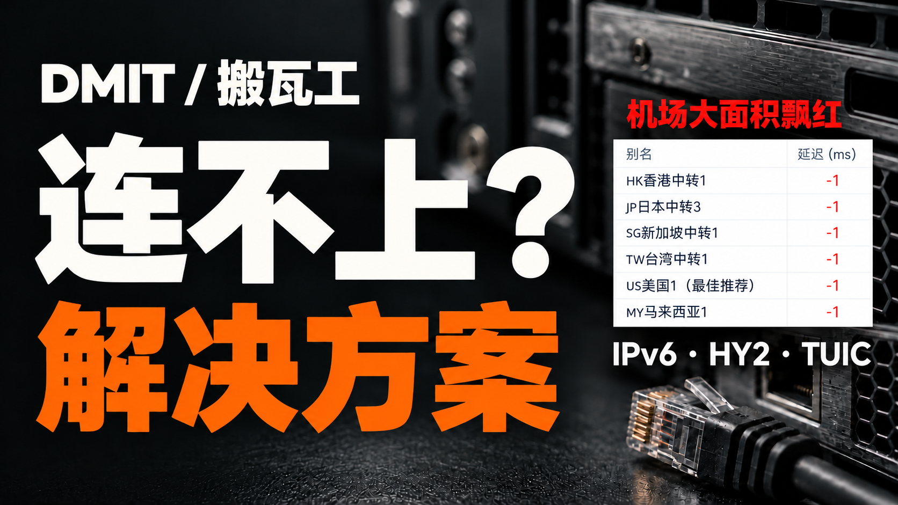
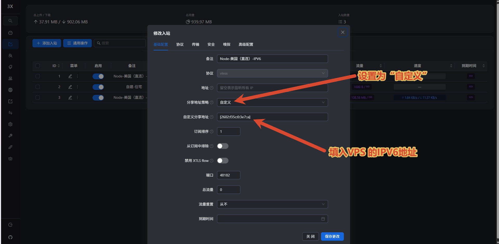
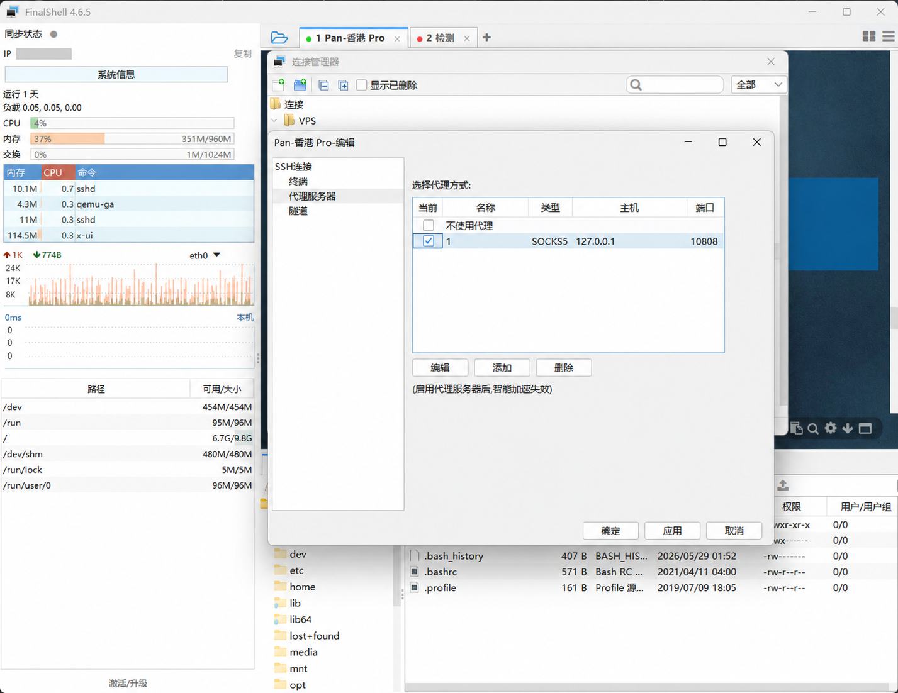
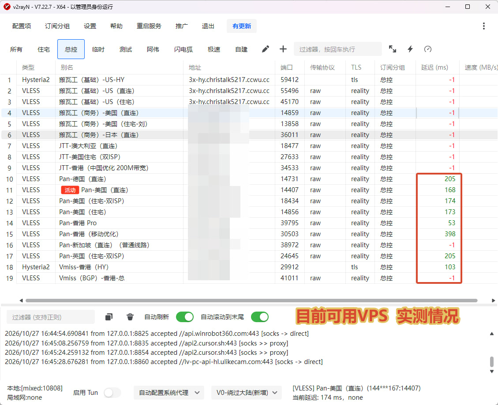
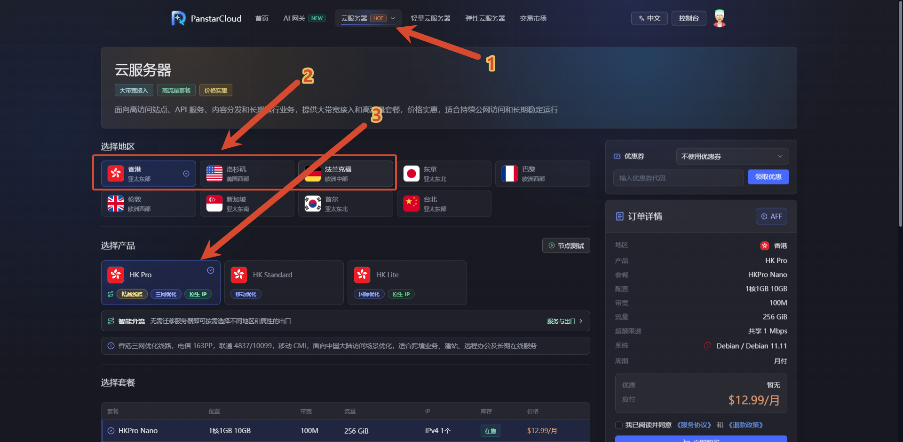
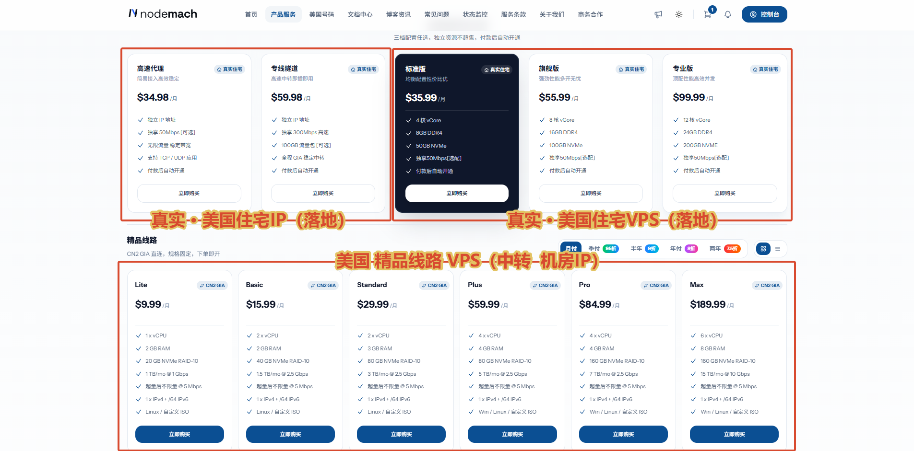

# 💻 DMIT、搬瓦工连不上？VPS被墙解决方案｜IPv6节点优先，HY2搭建、换IP与备用VPS

{ .hide-in-post width="300" align="left" style="border-radius: 8px; margin-right: 20px; box-shadow: 0 4px 10px rgba(0,0,0,0.1); margin-bottom: 10px;" }

<p class="hide-in-post"><strong>本期看点：</strong></p>

<div style="clear: both;" class="hide-in-post"></div>

<!-- more -->

<style>
  /* 隐藏封面和摘要 */
  .hide-in-post { display: none !important; }
  /* 选填：给大标题上方加点间距，避免和挪下来的视频贴得太紧 */
  h1 { margin-top: 25px !important; }
</style>

<div id="top-video" style="position: relative; padding-bottom: 56.25%; height: 0; overflow: hidden; max-width: 100%; border-radius: 8px; margin-bottom: 20px; box-shadow: 0 4px 10px rgba(0,0,0,0.1);">
  <iframe src="https://www.youtube.com/embed/rl2b9WKhySk" style="position: absolute; top: 0; left: 0; width: 100%; height: 100%;" title="YouTube video player" frameborder="0" allow="accelerometer; autoplay; clipboard-write; encrypted-media; gyroscope; picture-in-picture" allowfullscreen></iframe>
</div>

<script>
  (function(){
    var video = document.getElementById('top-video');
    var h1 = document.querySelector('h1'); // 抓取文档生成的第一个大标题
    if(video && h1) {
      h1.parentNode.insertBefore(video, h1); // 把视频节点插入到大标题前面
    }
  })();
</script>


---

## 📺 视频相关链接汇总
1. 🍺 本期视频同款——Nodemach（精品线路）【对标 DMIT】:[点击跳转][vircs]
1. 📖 其他中转服务器（VPS）：[点击查看详情][VPS推荐表]
1. 🌍 静态住宅IP：[点击查看详情][静态代理推荐表]
1. ✈️ TG交流群：[https://t.me/xiaovchat](https://t.me/xiaovchat)

## 🛠️ 代理软件
1. V2rayN（Windows 电脑版）：[https://github.com/2dust/v2rayN/releases](https://github.com/2dust/v2rayN/releases)
1. V2rayNG（Android 手机版）：[https://github.com/2dust/v2rayNG/releases](https://github.com/2dust/v2rayNG/releases)
1. Clash Verge Rev（Windows 电脑版）：[https://github.com/Clash-Verge-rev/clash-verge-rev/releases](https://github.com/Clash-Verge-rev/clash-verge-rev/releases/latest?utm_source=chatgpt.com)
1. Clash Meta for Android(Android 手机端):[https://github.com/MetaCubeX](https://github.com/MetaCubeX/ClashMetaForAndroid/releases/latest?utm_source=chatgpt.com)
1. Shadowrocket(小火箭)，请自行在苹果AppStore中下载

## 🔠 视频相关命令：

1. 服务器远程连接工具（FinalShell）： [https://www.hostbuf.com/t/988.html](https://www.hostbuf.com/t/988.html)

1. 安装Curl（PanstarVPS需要安装Curl，其他推荐VPS不需要）
```
apt update && apt install -y curl
```

- 安装Curl（以上如果报错，尝试一下命令）
```
apt-get install -y --allow-downgrades curl/bullseye
```


1. 3X-UI一键部署命令(版本 3.10.2-默认配置Hy IPv6节点)：
```bash
bash <(curl -fLsS https://raw.githubusercontent.com/kjxv/3x-ui/v3.10.2-preset-ipv6-hy2/deploy/preset/install.sh)
```
> 项目原地址：https://github.com/mhsanaei/3x-ui感谢原作者 mhsanaei 以及所有参与该项目开发、维护和贡献的开源作者。

1. Sing-box 一键部署命令
```bash
bash <(wget -qO- https://raw.githubusercontent.com/kjxv/sing-box/v1.3.28-vedio/sing-box.sh) -l
```

!!! abstract "上方是视频中用到的网址。"


---


## 🔗 临时共享订阅链接

考虑到部分群友暂时没有可用代理、无法直接获取 GitHub 上的订阅，现已通过自定义域名中转，方便直接导入 v2rayN 更新订阅。

*  **合并订阅（推荐）**

以下链接整合了下面五个订阅源，**导入一个链接即可获取节点**：

```text
https://sub.dlzys.shop/all
```

* 独立订阅（备用）

如果合并订阅无法正常导入，可以分别尝试以下链接：

**免费订阅链接 01**

```text
https://sub.dlzys.shop/sub1
```

**免费订阅链接 02**

```text
https://sub.dlzys.shop/sub2
```

**免费订阅链接 03**

```text
https://sub.dlzys.shop/sub3
```

**免费订阅链接 04**

```text
https://sub.dlzys.shop/sub4
```

**免费订阅链接 05**

```text
https://sub.dlzys.shop/sub5
```

**使用说明**

1. 复制推荐的合并订阅链接，添加到 v2rayN 的**订阅分组设置**中并保存。
2. 更新订阅时，选择 **「更新订阅（不通过代理）」**；不同版本的菜单名称可能略有区别，请选择不通过代理更新的选项。
3. 更新完成后测试节点延迟，优先选择有有效延迟数值的节点，再打开网页确认实际连接。超时或显示 `-1` 的节点先跳过。
4. 如果合并订阅无法正常导入，改用上面的独立订阅链接逐个尝试。

!!! warning "群内临时应急使用"
    - 免费节点稳定性无法保证，仅供临时应急，不保证速度或持续可用。
    - 节点来源于第三方，不建议用于敏感账户登录或支付操作。
    - **订阅链接仅供本群群友自用，请勿转载或公开传播。**

---

**四个方案怎么选**

!!! info "先判断自己属于哪种情况"
    **优先尝试方案一：使用 3X-UI 搭建 IPv6 节点。** 如果 IPv6 不可用，或者线路效果不理想，再尝试方案二 Sing-box；希望保留原服务器，可按方案三联系客服换 IP；急需恢复且原服务器无法使用，可按方案四选择其他 VPS。以上方案均不会自动把机房 IP 变成住宅 IP。

## 方案一：搭建IPv6节点 { #plan-1-ipv6 }

**首选方案：使用 3X-UI，通过 VPS 的公网 IPv6 地址搭建节点。** 当原来的 IPv4 地址被阻断，而 IPv6 仍能从本地访问时，可以改用 IPv6 入口尝试恢复连接。按目前的使用反馈，建议先尝试这一方案，再考虑下面的备选方法。

**开始前先确认条件**

- VPS 厂商提供了公网 IPv6，且系统已经正确配置；只有 `fe80::` 开头的链路本地地址，或 `fc` / `fd` 开头的私有地址，不能代替可从互联网访问的公网地址。
- **电脑或手机当前连接的网络也支持 IPv6**，并且能够访问这台 VPS 的 IPv6。VPS 有 IPv6，并不等于本地网络一定能用。
- 能够登录 3X-UI 面板，或者仍可通过 SSH、服务商控制台管理服务器。
- 服务商安全组和系统防火墙允许对应的 **IPv6 入站端口**；只配置 IPv4 放行规则可能不够。

**第一步：确认服务器的 IPv6**

先在服务商后台查看分配的公网 IPv6，并确认服务器已按厂商说明启用。复制地址时不要附带网段长度，例如后台显示 `2001:db8::1234/64`，填写节点地址时只使用地址部分。

> `2001:db8::1234` 是文档演示地址，不能实际连接。操作时必须替换为自己 VPS 的真实公网 IPv6。

**第二步：准备 3X-UI 面板**

已有 3X-UI 的用户直接进入面板操作。尚未安装的用户，可以先参考 [本站 3X-UI 安装教程](../2026-10-16-3x-ui/index.md)；若原 IPv4 无法直连，可通过服务商控制台，或参考方案二中的 FinalShell 本地代理方法连接服务器。

**第三步：按原来的方法配置入站**

进入 3X-UI 的入站列表，新增或编辑一个入站，备注可以写为「IPv6 应急」，方便与原来的节点区分。

**协议、传输、安全、端口、UUID、密钥等设置，均与以前配置 IPv4 节点的方法一致。** 例如原来使用 VLESS + Reality，现在仍然按同样的方法配置；下面截图标注的两处分享地址设置，是本次需要重点调整的地方。

**第四步：设置 IPv6 分享地址**

在入站的 **「基础配置」** 页面，按截图完成以下两项：

1. 将 **「分享地址策略」** 设置为 **「自定义」**。
2. 在出现的 **「自定义分享地址」** 中填写这台 VPS 的**公网 IPv6 地址**。按截图格式使用中括号，例如 `[2001:db8::1234]`，不要附带端口或 `/64` 等网段长度。



!!! tip "除了截图标注，其余设置与 IPv4 一致"
    这里修改的是 **「分享地址策略」和「自定义分享地址」**，使导出的节点使用 VPS 的 IPv6 地址。截图上方的 **「地址」** 是入站监听地址，不要与自定义分享地址混淆；截图中该项留空，表示监听所有 IP。使用自己的公网 IPv6，不要照抄截图或文档里的示例地址。

配置完成后点击 **「保存更改」**，确认入站已启用，并在服务商安全组和系统防火墙中放行相应的 IPv6 端口。VLESS + Reality 的常规 TCP 入站需要放行对应的 **TCP 端口**。

**第五步：导出并检查节点地址**

重新从 3X-UI 复制节点链接或更新订阅，导入 v2rayN 等客户端后，检查节点的 **「地址」** 字段，确认已经使用 VPS 的公网 IPv6。如果客户端仍保留旧的 IPv4 节点，请重新导入或更新订阅；也可以手动修改节点地址，端口、UUID、Reality 公钥、SNI 等参数继续使用对应入站生成的值。

- 在客户端独立的「地址」输入框中填写 IPv6 地址本身，通常不加中括号，也不附带端口。
- 如果手动拼接带端口的 URL 或节点链接，IPv6 地址需要用中括号包围，例如 `[2001:db8::1234]:443`，以客户端生成的格式为准。
- 如有 SNI / 服务器名称，保留协议要求的域名，不要因为连接地址换成 IPv6，就把 SNI 一并改成该 IPv6 地址。

这里调整的是 **客户端连接 VPS 的入口地址**。不需要因此把服务器的所有出站都强制改为 IPv6，最终网站看到的出口 IP 仍取决于服务器的出站与路由配置。

**第六步：测试连接与线路效果**

在客户端中测试节点延迟，再实际打开网页或播放视频，观察速度和稳定性。若无法连接，先检查本地 IPv6、服务器地址、入站监听和 IPv6 防火墙；若能连接但速度较慢，则还要考虑线路本身是否适合当前运营商。

!!! tip "能连接，不代表线路已经优化"
    部分厂商的 IPv6 线路没有针对本地运营商优化，可能出现延迟高、速度慢或高峰期不稳定。**例如博主本次测试的搬瓦工 IPv6：能够使用，但线路效果一般。** 如果能满足应急需要，可以先用；如果体验不理想，再尝试方案二的 Sing-box，或按方案三、四处理。更换协议也不保证能改善线路本身的问题。

---

<span id="plan-1-singbox" class="emergency-anchor"></span>

## 方案二：部署临时应急节点 { #plan-2-singbox }

这是临时应急方案。前提是服务器仍然可以通过 SSH 连接：能够直连时正常登录即可；无法直连但本地代理可用时，可以让 SSH 客户端通过本地代理连接 VPS。

**适用条件**

- 仍能通过 SSH 直接连接 VPS，或可借助本地代理完成连接；
- 拥有服务器的 `root` 权限，或可以使用 `sudo` 切换到 `root`；
- VPS 本身可以访问互联网；
- 可以在服务商安全组和系统防火墙中放行脚本生成的端口。

**第一步：必要时为 FinalShell 设置本地代理**

如果 VPS 被当前网络阻断、FinalShell 无法直连，可以让 SSH 通过本地代理连接。**前提是本地已有一条能连接目标 VPS 的可用代理**；可先尝试上面的临时共享订阅。

1. 打开 v2rayN 或其他代理软件，更新订阅、测试延迟并选中一条可用节点，确认代理已经正常运行。
2. 在 FinalShell 的**连接管理器**中找到该 VPS，右键选择 **「编辑」**。
3. 在左侧进入 **「代理服务器」**，点击 **「添加」**，代理类型选择 **SOCKS5**。
4. 主机填写 `127.0.0.1`；截图中 v2rayN 的本地端口为 `10808`。请以软件当前显示的 SOCKS 或混合监听端口为准，其他软件也要按实际端口填写。
5. 保存代理设置，**勾选刚添加的代理**，点击 **「应用 → 确定」**，然后重新连接 VPS。



> `127.0.0.1:10808` 指的是这台电脑上的代理服务，并非 VPS 的 SSH 端口或新部署的 Hy 节点端口。VPS 地址、SSH 端口和登录信息仍填写原来的值。如果代理也无法访问该 VPS，请改看方案三或方案四。

**第二步：运行 Sing-box 一键部署脚本**

连接 VPS 后，先切换到 `root` 用户：

```bash
sudo -i
```

然后运行下面的**固定视频教程版**部署命令，版本为 `v1.3.28-vedio`：

```bash
bash <(wget -qO- https://raw.githubusercontent.com/kjxv/sing-box/v1.3.28-vedio/sing-box.sh)
```

脚本交互界面出现后，根据提示选择语言和安装选项；需要应急测试的协议为 **Hysteria2（Hy）**。完成部署后，记录生成的端口，并在服务商安全组和系统防火墙中放行对应的 **UDP 端口**。

如果希望自动填写参数、使用中文极速安装，可运行：

```bash
bash <(wget -qO- https://raw.githubusercontent.com/kjxv/sing-box/v1.3.28-vedio/sing-box.sh) -l
```

该标签固定用于本期教程，后续 `main` 同步上游不会改变这条命令对应的脚本。具体版本信息和使用说明见 [v1.3.28-vedio Release](https://github.com/kjxv/sing-box/releases/tag/v1.3.28-vedio)。已有部署的用户应先保留原配置，避免覆盖正在使用的服务。

!!! danger "运行远程脚本前请确认"
    上面的命令会下载并以服务器权限直接执行脚本。建议先打开 [kjxv/sing-box 项目页面](https://github.com/kjxv/sing-box) 查看来源和更新记录。谨慎操作时，也可以先下载并检查脚本，再手动执行：

    ```bash
    wget -O sing-box.sh https://raw.githubusercontent.com/kjxv/sing-box/v1.3.28-vedio/sing-box.sh
    less sing-box.sh
    bash sing-box.sh
    ```

**第三步：导出并测试 Hy 节点**

安装完成后，可以运行下面的快捷命令查看节点信息：

```bash
sb -n
```

复制生成的 Hysteria2 节点链接，导入 v2rayN 等兼容客户端后进行延迟和连接测试。如果节点无法使用，请优先检查：

1. 安全组和系统防火墙是否放行了生成的 **UDP 端口**；
2. 客户端是否支持 Hysteria2；
3. VPS 的公网 IP 是否仍然可以从当前网络访问；
4. 服务器时间、域名解析和出站网络是否正常。

> 能通过代理登录 SSH，只说明这条代理能够访问服务器，不代表新部署的 Hy 节点一定能从本地直连使用。如果测试仍失败，可按方案三联系服务商更换 IP，或按方案四选择其他可用 VPS。

---

<span id="plan-2-change-ip" class="emergency-anchor"></span>

## 方案三：申请更换公网地址 { #plan-3-change-ip }

如果希望继续使用原 VPS，可以联系服务商客服，或在用户后台提交工单，说明当前网络无法连接，请客服协助检查，并咨询是否支持更换公网 IP。

**如果暂时不着急使用，建议先等几天，待情况相对稳定后再考虑更换。** 如果急需恢复，可先用临时订阅，或尝试其他应急方案；新 IP 是否可用仍需实际测试。

提交工单前，准备好以下信息：

- VPS 订单号、实例名称、当前 IP，以及大致开始异常的时间；
- 当前使用的运营商和地区，SSH、面板和节点分别是否可以连接；
- 询问能否免费更换、是否收费，以及换 IP 是否影响现有数据。

客服完成更换后，将 FinalShell 的服务器地址、客户端节点地址及必要的域名解析更新为新 IP，再重新测试。**不要把更换 IP 等同于重装系统**，是否需要重建实例、数据能否保留，应以客服明确说明为准。

---

<span id="plan-3-vps" class="emergency-anchor"></span>

## 方案四：另外购买一台备用 VPS { #plan-4-vps }

如果原服务器已经无法使用，或者需要继续搭建住宅 IP 出口，可以先选择一台当前连接正常的 VPS 作为中转或基础服务器，再在其后配置自己合法持有或授权使用的住宅 IP 服务。

按目前整理的反馈，可优先测试以下备选。Panstar 截图记录的是 **2026 年 10 月 27 日** 的测试情况，不能代表之后每个时间点、每个运营商的连接状态。

| 备选产品 | 更适合的场景 |
| --- | --- |
| 美国三网精品 VPS | 面向美国方向使用，作为临时中转或住宅 IP 前置服务器 |
| 德国 9929 VPS | 需要欧洲地区出口或中欧方向连接的用户 |
| 香港 Pro VPS | 更看重亚洲地区延迟和香港方向连接的用户 |
| Nodemach 美国精品 VPS | 需要美国地区出口的用户，对标 DMIT（9.99美金/月） |



!!! info "测试结果具有时效性"
    截图只代表测试当时的网络情况。线路状态、延迟、库存和价格都可能发生变化，购买前建议先月付测试，并以官网实时显示为准。

**Panstar：美国、德国 9929、香港 Pro**

[进入 Panstar 注册页面](https://panstar.ai/register?aff=DCAD1VCH)



---

**Nodemach：美国 三网精品线路**

官网注册链接：[进入 Nodemach 注册页面][vircs]

购买指引教程：[点击跳转](../../../../../../tools/2026-10-24-VPS-nodemach)



[查看本站 VPS 实测推荐与套餐说明](../../../recommend/1-vps/index.md)

> **注意：** VPS 本身通常属于机房 IP。若最终目标是住宅 IP，需要在可用 VPS 上继续配置合规的住宅代理或 ISP 出口；购买 Panstar VPS 并不等于直接获得住宅 IP。

---

**如何选择**

- **当前没有可用代理，想先救急：** 先尝试上面的临时共享订阅，并测试实际连接。
- **本地和 VPS 的 IPv6 都可用：** 首选方案一，用 3X-UI 搭建 IPv6 入口节点。
- **IPv6 不能用或效果不理想，但仍能登录 VPS：** 按方案二尝试 Sing-box 部署 Hy 节点。
- **想保留原服务器且不着急使用：** 按方案三联系服务商，待情况稳定后再考虑换 IP。
- **原服务器无法使用、又急需恢复：** 按方案四测试其他可用 VPS。
- **必须使用住宅 IP：** 在可用 VPS 的基础上，另行配置自己拥有使用权限的住宅 IP 服务。

本文方案仅用于正常的网络维护、远程办公和个人服务恢复。请遵守所在国家或地区的法律法规以及服务商条款，不要用于未经授权的访问或其他违规用途。


!!! Warning "**免责声明**"
    本文档及相关教程内容仅供计算机网络技术交流与学习测试使用。请务必严格遵守您所在国家或地区的法律法规，切勿用于任何非法用途。
    
--8<-- "includes/links.md"
