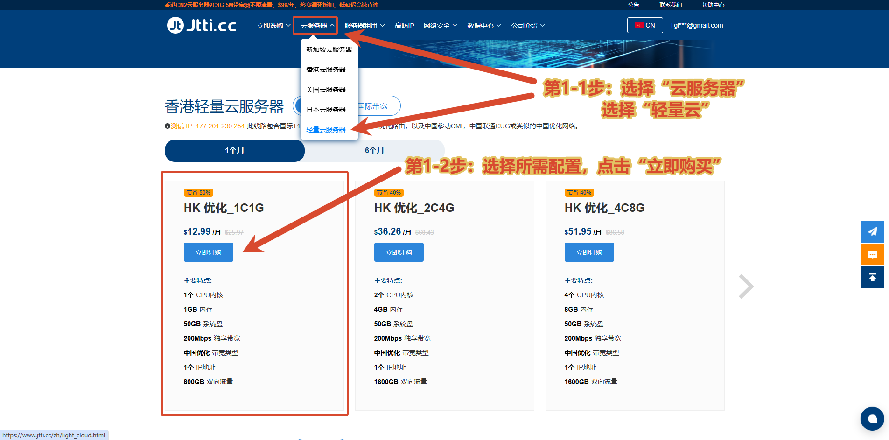
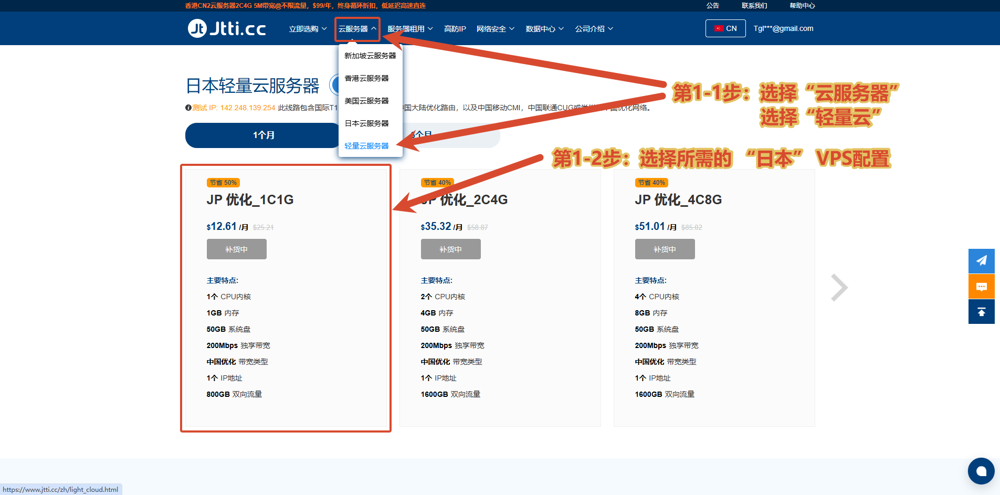
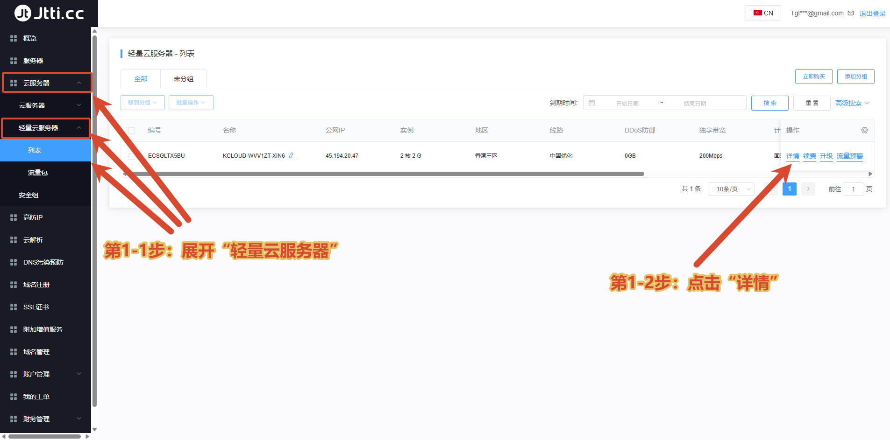
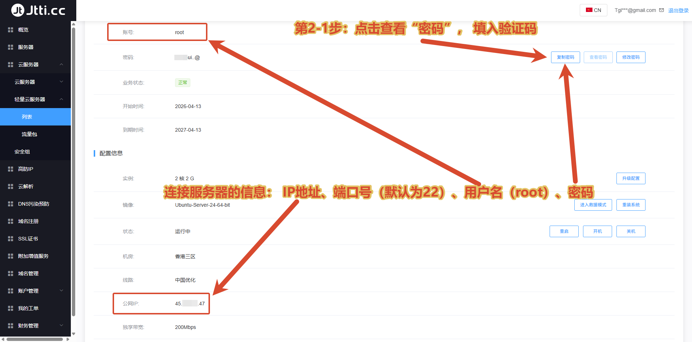

[← 返回 VPS 推荐表](../../../recommend/1-vps/index.md)

# 🖥️ JTTI VPS 购买与首次使用图文教程

本文按官网公开套餐，分别说明**香港、日本轻量云服务器如何选购**，以及购买完成后如何查看连接 VPS 所需的信息。

**目前已取消本站专属优惠。** 直接按官网显示的配置与付款周期选购，无需填写原专属优惠码，也无需为专属优惠额外修改流量。

👉 **[进入 JTTI 轻量云选购页面](https://www.jtti.cc/zh/light_cloud.html?k=T7KBH7)**

<nav class="jtti-guide-nav" aria-label="JTTI 图文教程快速导航">
  <a href="#jtti-hk">🇭🇰 香港套餐购买</a>
  <a href="#jtti-jp">🇯🇵 日本套餐购买</a>
  <a href="#jtti-first-use">🔑 首次使用与连接</a>
</nav>

> 下方价格、配置和库存均为所附截图中的记录，用于说明选购方法；实际下单请以官网实时显示及结算金额为准。

## 🇭🇰 香港轻量云购买指引 { #jtti-hk }

**第1步：进入轻量云页面**

在官网顶部展开 **「云服务器」**，点击 **「轻量云服务器」**，进入后确认页面标题为 **「香港轻量云服务器」**。

**第2步：选择付款周期和配置**

根据需要选择付款周期，截图演示为 **「1个月」**。找到 **「HK 优化_1C1G」**，核对配置后点击 **「立即订购」**。

截图中的示例配置：

- **CPU／内存：** 1核／1GB。
- **系统盘：** 50GB。
- **独享带宽：** <strong class="jtti-highlight">200Mbps</strong>，中国优化线路。
- **流量：** <strong class="jtti-highlight">800GB 双向流量</strong>。
- **IP：** 1个。
- **截图参考价格：** <strong class="jtti-highlight">12.99美元／月</strong>。

继续按页面提示确认所需配置和系统镜像，核对地区、付款周期与最终应付金额后再付款。购买其他配置时，按自己选择的套餐信息核对即可。

## 🇯🇵 日本轻量云购买指引 { #jtti-jp }

**第1步：进入日本轻量云页面**

同样从顶部 **「云服务器 → 轻量云服务器」** 进入，切换到日本地区后，确认页面标题为 **「日本轻量云服务器」**。

**第2步：选择付款周期和配置**

根据需要选择付款周期，截图演示为 **「1个月」**。找到 **「JP 优化_1C1G」**，核对配置；有货时再点击对应的订购按钮。

截图中的示例配置：

- **CPU／内存：** 1核／1GB。
- **系统盘：** 50GB。
- **独享带宽：** <strong class="jtti-highlight">200Mbps</strong>，中国优化线路。
- **流量：** <strong class="jtti-highlight">800GB 双向流量</strong>。
- **IP：** 1个。
- **截图参考价格：** <strong class="jtti-highlight">12.61美元／月</strong>。

**截图时日本套餐显示「补货中」**，说明当时暂不能直接购买。请以当前页面的库存状态为准；若仍显示补货中，可等待补货或咨询客服，不要误选其他地区的套餐。

订单配置页的操作与香港套餐相同：按需要选择配置及系统，核对订单金额后付款。

## 🔑 VPS 首次使用图文教程 { #jtti-first-use }

完成付款并等待服务器开通后，登录 JTTI 用户中心，按下面两步查看连接信息。**本节后台截图使用的是已购买的 2核2GB 实例，操作入口相同，实际配置以自己的订单为准。**

### 第1步：打开服务器详情 { #jtti-server-details }

在用户中心左侧，依次展开 **「云服务器 → 轻量云服务器 → 列表」**，找到自己的 VPS，点击该行右侧的 **「详情」**。

如果列表较宽、没有看到操作列，可以将列表底部的横向滚动条向右拖动，再找到 **「详情」**。

### 第2步：查看账号、密码与公网 IP { #jtti-connection-info }

进入详情页面后，查看自己的连接信息：

- **公网 IP：** 在 **「公网IP」** 一栏查看，用作 SSH 客户端的主机地址。
- **SSH 端口：** 默认通常为 `22`；如果自己修改过，使用修改后的端口。
- **用户名：** Linux 实例截图中的账号为 `root`，以自己的详情页显示为准。
- **密码：** 在密码区域点击 **「查看密码」** 或 **「复制密码」**；如果弹出验证提示，按页面要求完成验证后再查看或复制。

将以上信息填入 FinalShell 等 SSH 客户端，保存后连接 VPS。请使用**自己实例的实际 IP、端口、账号和密码**，截图只用于说明字段位置。

本教程中的 `root` 与 SSH 说明适用于 Linux 实例；如果购买的是 Windows 系统，应使用对应的远程桌面连接方式和账号信息。

[← 返回 VPS 推荐表](../../../recommend/1-vps/index.md)

