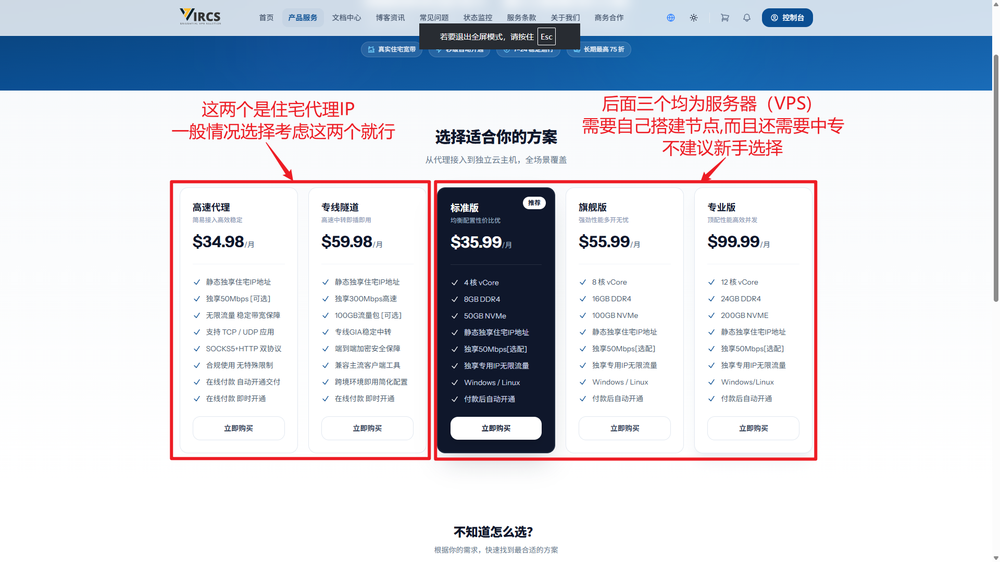
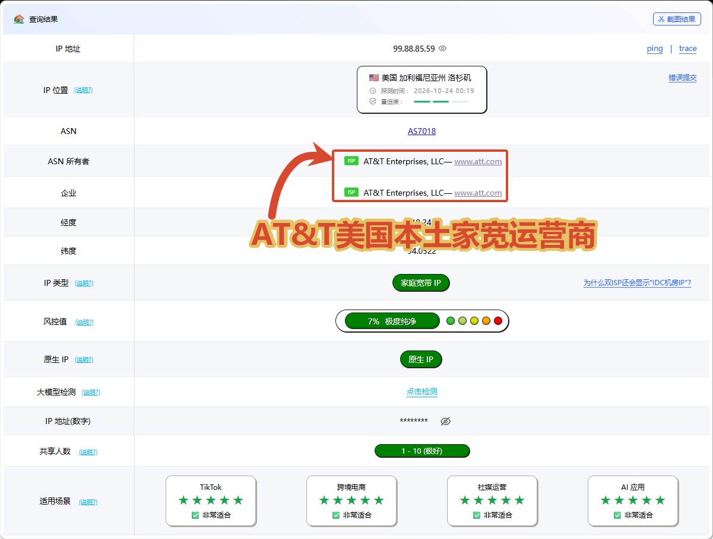

[← 返回住宅 IP 推荐表](../../../recommend/3-isp/index.md)

# 🏠 NodeMach 住宅 IP 选购与检测图文教程

本文将住宅 IP 推荐页中的两张原有截图整理为独立教程。截图保留旧品牌 **VIRCS** 的界面，当前通过 **NodeMach** 入口查看产品；套餐名称、价格和可选资源以当前页面为准。

👉 **[进入 NodeMach 官网／注册入口](https://www.nodemach.com/welcome?vcd=9467e966)**

[产品类型选择](#nodemach-isp-types) · [住宅出口检测](#nodemach-isp-check) · [购买与配置入口](#nodemach-isp-next)

## 🛒 区分住宅产品类型 { #nodemach-isp-types }

打开官网的产品服务页面，先分清**成品住宅代理**与**住宅 VPS**。原截图左侧两款为代理接入产品，右侧三款是需要自行安装、部署和维护的 VPS。

### 高速代理与专线隧道

截图中的历史示例分别为：

| 截图产品 | 当时展示的配置 | 当时展示的月价 |
| --- | --- | --- |
| 高速代理 | 静态独享住宅 IP；50Mbps 可选；不限流量；SOCKS5／HTTP | 34.98 美元／月 |
| 专线隧道 | 静态独享住宅 IP；300Mbps；100GB 流量包可选；GIA 中转 | 59.98 美元／月 |

上表用于说明两类产品的区别，**不是当前在售价格承诺**。选购时同时核对带宽、流量额度、协议和是否包含入口线路，不要只按产品名称下单。

### 住宅 VPS 与成品代理

原截图右侧的标准版、旗舰版、专业版属于 VPS。购买后还需部署代理服务，按需要配置入口或中转；它们不等同于开通后直接获取代理连接信息的成品服务。

如果主要需求是获取住宅代理地址、端口、账号与密码，先查看代理接入类产品；如果需要自建、维护和调整服务，再比较住宅 VPS。

## 🔎 检查住宅出口信息 { #nodemach-isp-check }

下面是原文中的美国出口样本。检测时间为 **2026 年 10 月 24 日**，页面显示美国洛杉矶、`AS7018`，ASN 所有者为 **AT&T Enterprises, LLC**。

配置好自己的代理后，在**使用该代理的浏览器或客户端环境**中检查：

1. 当前出口 IP 是否与所购资源一致。
2. 国家、城市及 ASN 信息是否符合需要。
3. 实际访问速度、延迟和目标网站可用性是否符合预期。

截图中的“家宽”“原生”“风险值”等为检测网站对该样本的判断，不能单独证明物理接入方式，也不能代表其他 IP 的当前结果。

## 📖 购买与配置入口 { #nodemach-isp-next }

- 注册与产品分类可参考现有的 [NodeMach 注册与购买图文教程](../Buy-Guide-Nodemach/index.md)。其中后半部分的安装系统步骤仅适用于 VPS。
- 如果购买住宅 VPS，可继续查看 [自建 SOCKS5 与中转的视频文档](../../../blog/posts/2026-09-26-Multi-EasyGost/index.md)。
- 需要比较成品代理时，返回 [住宅 IP 平台推荐表](../../../recommend/3-isp/index.md)。

本文目前整理产品分类和检测两张已有截图，住宅代理的下单、付款和提取后台步骤将在补齐对应截图后更新。
