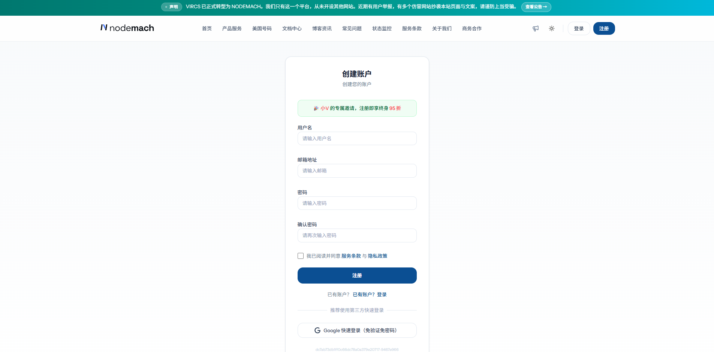
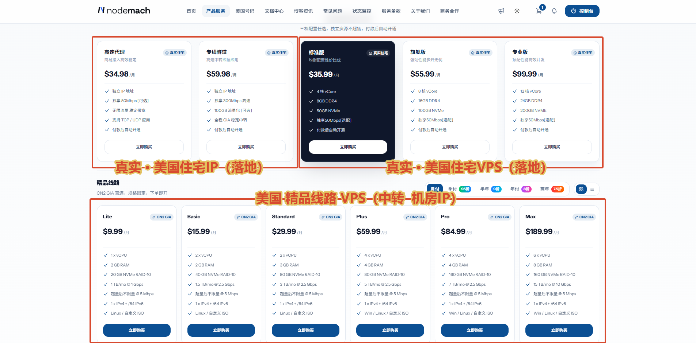
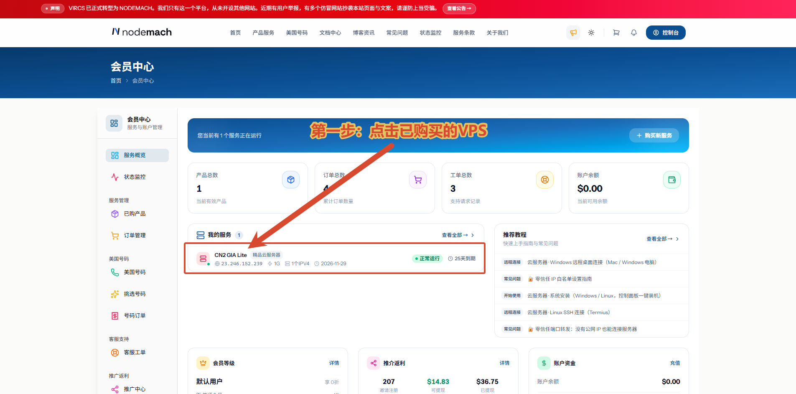
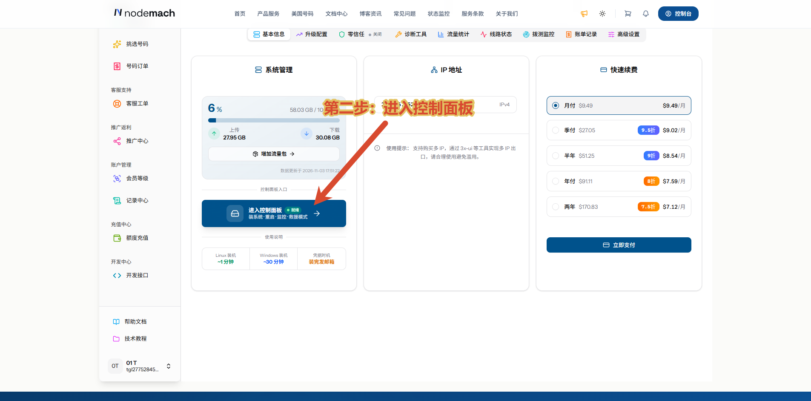
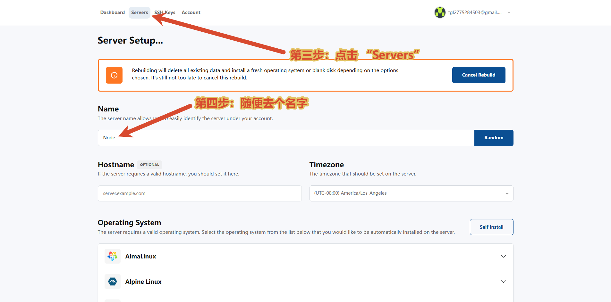
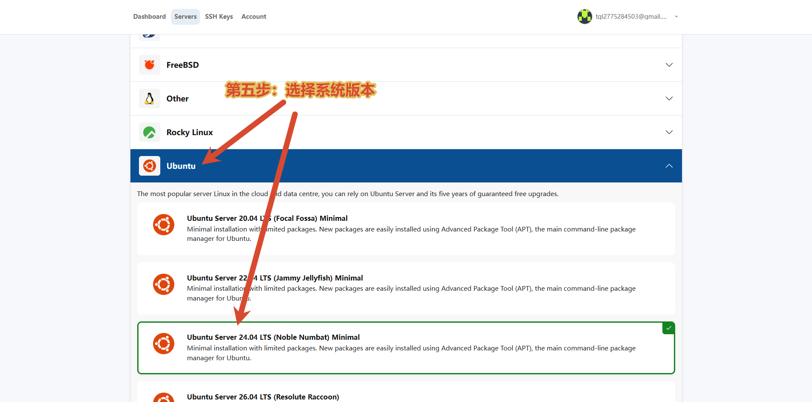
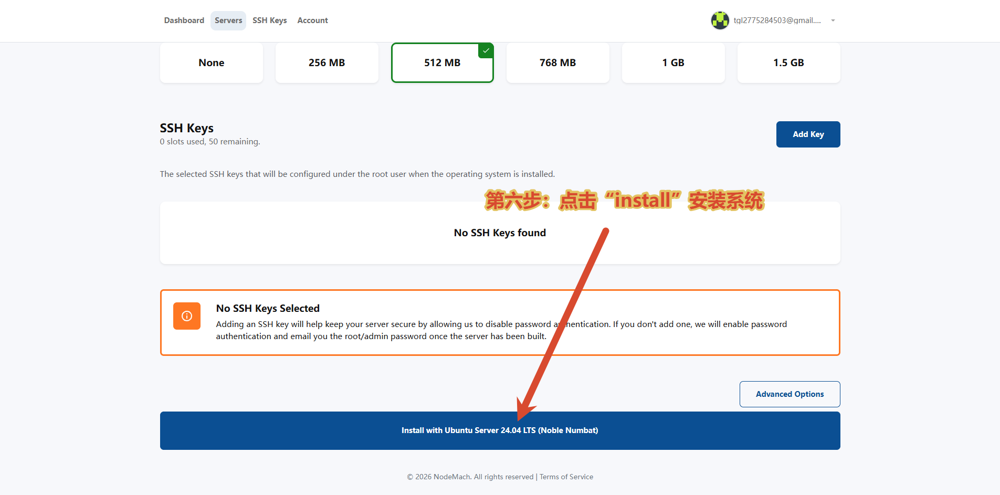
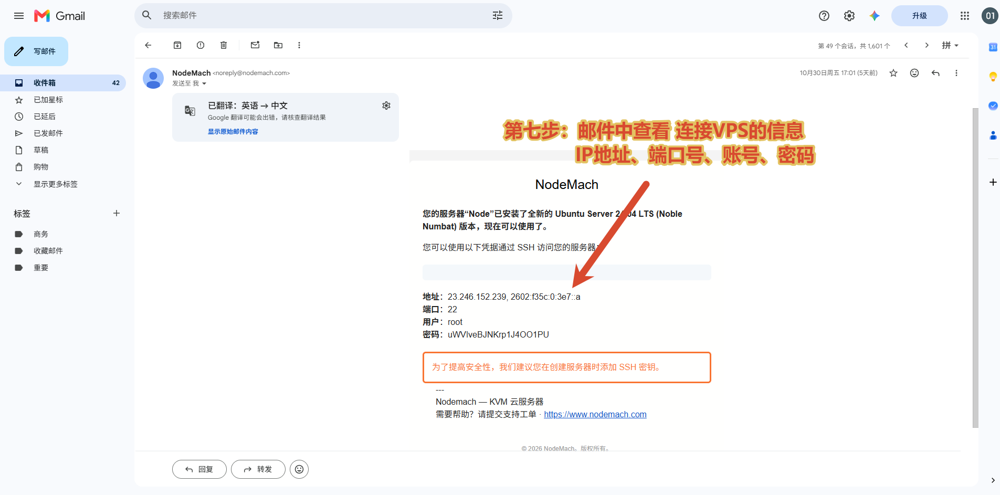

# NodeMach 注册与购买图文教程

本文介绍如何通过小V专属邀请注册、区分产品类型，并以 **CN2 GIA Lite** 为例完成选购。

## 一、通过邀请入口注册

👉 **[点击进入小V专属邀请页面，注册享终身95折](https://www.nodemach.com/welcome?vcd=9467e966)**

打开后，先确认页面出现绿色提示：**「小V的专属邀请，注册即享终身95折」**，再填写用户名、邮箱和密码，阅读服务条款与隐私政策后完成注册。

> 如果没有看到专属邀请提示，请重新通过上方邀请入口打开页面，再进行注册。已有账户的邀请归属不会因点击链接而改变。

## 二、进入产品服务，选择产品类型

注册并登录后，点击顶部导航中的 **「产品服务」**。图中三个区域分别对应：

* 产品说明，不清楚的可以咨询博主

**注意：下方 CN2 GIA 系列属于机房 IP VPS，不属于住宅 IP 产品。**

---

## 🖥️ VPS初次使用图文教程 { #vps-first-use }

购买完成后，按照下面的第 1～7 步进入控制面板、安装操作系统，再通过邮件获取 VPS 的连接信息。截图以 **Ubuntu Server 24.04 LTS** 为例；后续搭建教程如有系统版本要求，请按对应教程选择。

!!! warning "安装前先确认服务器状态"
    以下操作适用于刚购买、尚未部署服务的 VPS。安装或重装系统会清空服务器原有数据；如果已经使用过这台服务器，请先备份，确认后再操作。

### 第1步：打开已购买的 VPS

登录 NodeMach 会员中心，在 **「我的服务」** 中找到已购买的 VPS，点击对应的服务器卡片，进入服务详情页面。

### 第2步：进入控制面板

在服务详情的 **「系统管理」** 区域，点击 **「进入控制面板」**，打开用于安装系统和管理服务器的控制面板。

### 第3步：进入 Servers 页面

点击控制面板顶部的 **「Servers」**，找到需要配置的服务器，进入系统安装设置页面。若已经显示截图中的 **「Server Setup」** 页面，可以继续下一步。

### 第4步：填写服务器名称

在 **「Name」** 一栏填写一个便于自己识别的名称，例如 `Node`。这是服务器的备注名称，不是登录账号或密码。

下面这张图同时标出了**第 3 步和第 4 步**的位置：

### 第5步：选择操作系统

向下找到 **「Operating System」**，展开 **「Ubuntu」**，选择截图中的 **「Ubuntu Server 24.04 LTS (Noble Numbat) Minimal」**。选中后，检查对应选项是否出现绿色边框和勾选标记。

### 第6步：安装系统并等待完成

继续向下滑动，核对已经选择的系统版本，点击页面底部的 **「Install with Ubuntu Server 24.04 LTS (Noble Numbat)」** 按钮，按页面提示确认并等待安装完成。

本示例没有添加 SSH 密钥，页面提示会在服务器安装完成后，通过邮件发送登录密码。如果你选择了 SSH 密钥登录，请使用自己配置的密钥连接。

安装过程中先等待页面状态更新，不要重复提交安装或重装操作。完成后，再按下一步查看邮件。

### 第7步：查看邮件并连接 VPS

打开注册 NodeMach 时使用的邮箱，找到系统安装完成的通知邮件，查看其中的 **IP 地址、SSH 端口、用户名和密码**。

将**自己的邮件**中的连接信息填入 FinalShell 等 SSH 客户端：

- **主机地址：** 邮件中的 VPS 公网 IP。
- **端口：** 以邮件显示为准，截图示例为 `22`。
- **用户名：** 以邮件显示为准，截图示例为 `root`。
- **密码：** 使用本次安装完成后邮件提供的密码；如果选择的是 SSH 密钥登录，则使用对应密钥。

截图中的信息仅用于说明字段位置，请使用自己服务器的实际信息。若暂未收到邮件，可检查垃圾邮件文件夹，并确认系统已安装完成；仍找不到时可联系客服或提交工单。

