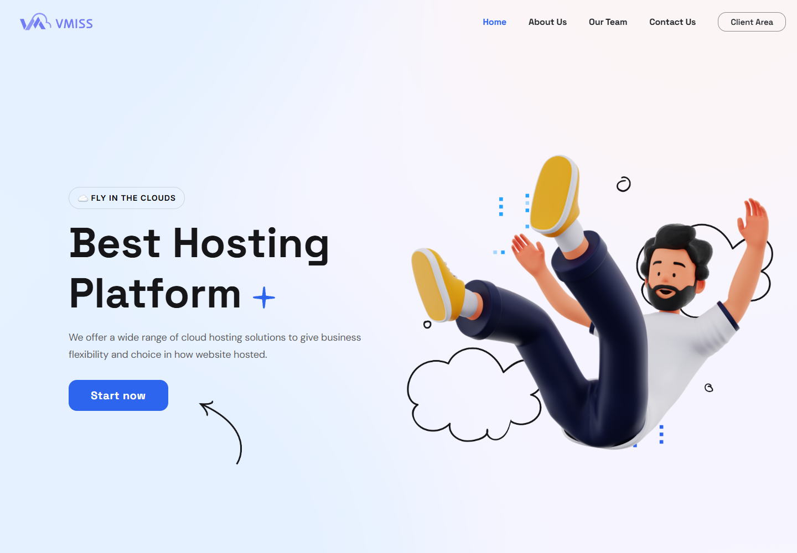
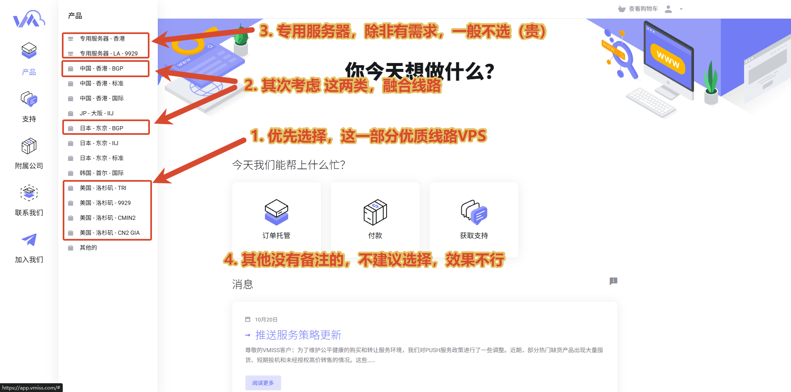
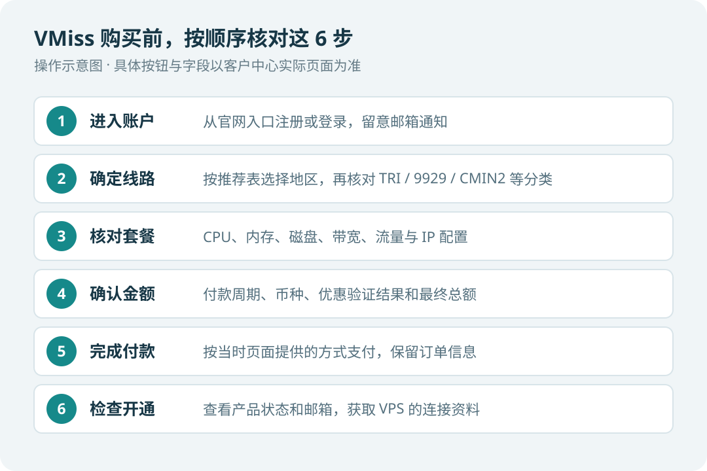
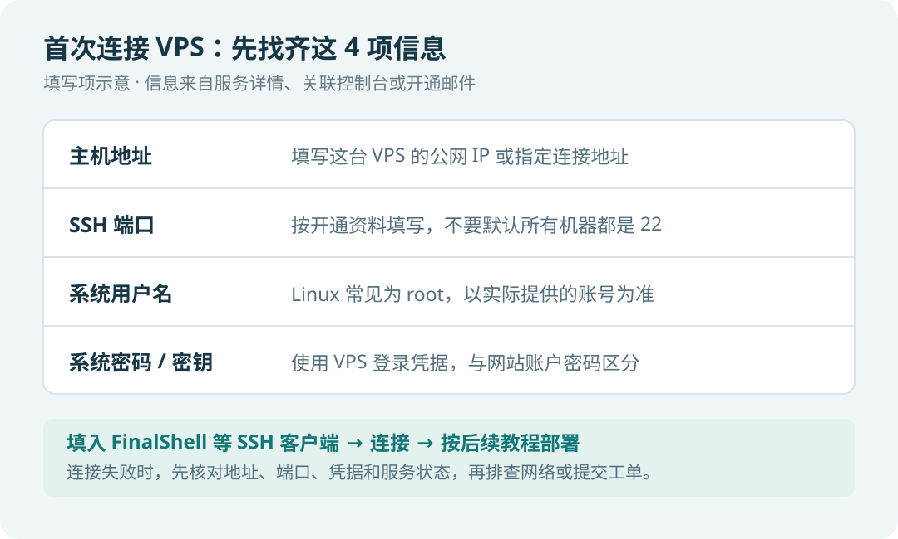

<!-- 资料与截图说明：原始线路图来自博主提供的 vmiss 图片文件夹；官网主站截图于 2026-11-04 实际采集。客户中心本次触发 Cloudflare 安全验证，未进入注册、配置、结算和已购服务后台；下方流程图明确为示意图，不是后台实拍。后续可在对应步骤补充真实截图。 -->

[← 返回 VPS 推荐表](../../../recommend/1-vps/index.md)

# 🖥️ VMiss VPS 购买与首次使用图文教程

第一次购买 VMiss，先确定**地区与线路**，再选择具体配置和付款周期。本文按这个顺序整理选购方法，并说明开通后需要核对哪些连接信息。

👉 **[进入 VMiss 官网／注册入口](https://app.vmiss.com/aff.php?aff=3992)**

<nav class="vmiss-guide-nav" aria-label="VMiss 教程快速导航">
  <a href="#vmiss-lines">🧭 地区与线路选择</a>
  <a href="#vmiss-purchase">🛒 套餐选购与付款</a>
  <a href="#vmiss-first-use">🔑 首次使用与连接</a>
</nav>

> 本页使用小V提供的线路选择原图、官网主站截图和操作流程示意图。套餐名称、库存、价格及具体按钮位置，请以下单时客户中心的实际显示为准。

## 🌐 官网与注册入口 { #vmiss-entry }

**第1步：进入客户中心。** 推荐直接通过上方入口打开 `app.vmiss.com`。如果先进入 `www.vmiss.com` 主站，点击右上角的 **「Client Area」**，或首页的 **「Start now」**，也会进入客户中心。

**第2步：注册或登录。** 已有账户直接登录；新用户在登录页面寻找**新建账户／注册**入口，按页面要求填写资料。邮箱应能正常接收订单、账单及开通相关邮件；如有邮箱验证提示，按提示完成。

进入客户中心后，再选择产品分类。账户密码与 VPS 的系统登录密码分别保管，后面连接服务器时要使用对应的 VPS 登录凭据。

## 🧭 VPS地区与线路 { #vmiss-lines }

### 先看截图中的分类

下面的图片保留了小V的原始标注。选购顺序来自个人使用经验，实际体验还取决于你的所在地、运营商和使用时段。

按图中的顺序理解：

1. **优先对照美国洛杉矶的优化线路**，如 TRI、9929、CMIN2、CN2 GIA，再看有没有适合自己的配置。
2. **香港 BGP、日本东京 BGP 作为备选**，选择前留意线路说明。VMiss 在[东京 BGP 产品页](https://app.vmiss.com/store/jp-tokyo-bgp?language=chinese)提示了高峰时段可能出现的延迟、丢包及速度波动。
3. **专用服务器单独看需求**，本教程主要演示 VPS 的选择思路。
4. 图中未标注的分类，先了解线路和用途后再决定，避免只看地区或价格就下单。

### 按完整线路名称选

同样写着“美国洛杉矶”，也可能属于不同线路。按推荐表中当前行的线路进入，再核对套餐名称。

| 推荐表中的线路 | 客户中心分类或产品名称中的识别词 | 官方分类参考 |
| --- | --- | --- |
| 美国三网优化 | 洛杉矶、TRI／三网优化 | [查看 TRI 分类](https://app.vmiss.com/store/us-los-angeles-tri?language=chinese) |
| 美国 9929 | 洛杉矶、9929 | [查看 9929 分类](https://app.vmiss.com/store/us-los-angeles-9929?language=chinese) |
| 美国 CMIN2 | 洛杉矶、CMIN2 | [查看 CMIN2 分类](https://app.vmiss.com/store/us-los-angeles-cmin2?language=chinese) |
| 美国 CN2 GIA | 洛杉矶、CN2 GIA；套餐名可能包含 `US.LA.CN2` | [查看 CN2 GIA 分类](https://app.vmiss.com/store/us-los-angeles-cn2?language=chinese) |
| 日本东京 BGP | 日本、东京、BGP | [查看东京 BGP 分类](https://app.vmiss.com/store/jp-tokyo-bgp?language=chinese) |

**上面的链接用于定位分类；具体商品仍要在分类内选择。** 如果菜单增加了 DC2、DC3 等后缀，也要核对机房与线路说明，不能只按名称前半段判断。

## 🛒 套餐选购与付款 { #vmiss-purchase }

下面是选购时的核对顺序，**属于操作示意图**。

### 第1步：核对套餐配置

选择目标分类后，对照推荐表核对以下项目：

- **CPU、内存、磁盘**：不要只凭 Basic、Core、Pro 等档位名称判断配置。
- **端口带宽与月流量**：例如 <strong class="vmiss-highlight">200Mbps</strong> 是端口带宽，<strong class="vmiss-highlight">400GB／月</strong> 是流量额度，两者含义不同。
- **IP 配置**：确认套餐提供的 IPv4／IPv6 是否满足后续搭建教程的要求。
- **库存**：以当时页面能否订购为准；缺货时返回推荐表比较其他方案。

有货时，选择对应套餐的**立即订购／Order Now**，继续按页面提示核对可选项。

### 第2步：确认周期金额

核对付款周期和页面币种。**显示 `CAD` 时表示加元**；月付、季付、年付等周期的最终应付金额，需要在结算前看清。

如果页面提供系统镜像、附加 IP 或其他选项，按实际需求选择，并查看右侧或下方的订单合计。后续要跟随本站搭建教程时，系统版本按对应教程要求选择。

本站推荐表原记录的优惠码为 `10%OFF`。可以在页面提供的优惠码位置尝试填写并验证，**确认页面实际接受优惠、总额发生正确变化后，再决定是否付款**。本页不保证该码在所有商品或时间都适用。

### 第3步：付款并查开通

确认地区、线路、配置、周期、币种和总额后，再按页面当时提供的付款方式完成支付。

付款后查看**订单／产品状态与注册邮箱**，等待官方提供开通结果。如果仍显示待处理，先查看账单是否已支付、订单是否还在审核，必要时通过客户中心提交工单。开通耗时以实际处理为准。

## 🔑 首次使用与连接 { #vmiss-first-use }

### 第1步：找到服务资料

登录客户中心，找到已经购买的 VPS，打开对应的产品／服务详情，核对产品名称、地区及运行状态。

**连接资料可能显示在服务详情、关联控制台或开通邮件中**。重点找下面四项；找不到时，向客服说明订单或服务编号并咨询。

| 需要的信息 | 在客户端中如何使用 |
| --- | --- |
| 公网 IP／连接地址 | 填入 SSH 客户端的主机地址 |
| SSH 端口 | 按实际开通资料填写；不要把所有服务器都默认当作 22 |
| 系统用户名 | Linux 常见为 `root`，以该系统提供的账号为准 |
| 系统密码／SSH 密钥 | 使用这台 VPS 的登录凭据，注意与 VMiss 网站账户密码区分 |

### 第2步：核对系统版本

如果已安装的系统符合后续教程要求，可以直接继续使用。确需重新安装时，在该 VPS 的管理入口寻找系统安装／重装相关功能，按官方页面说明操作。

**重装系统会清空服务器原有数据。** 已经使用过的 VPS，应先备份再操作；重装完成后重新核对 IP、端口和登录凭据。

### 第3步：用客户端连接

以 FinalShell 等 SSH 客户端为例，新建一个 **SSH 连接**，填入上表中的主机地址、端口、用户名和密码／密钥，再连接服务器。

成功进入 Linux 命令行后，再按相应的视频文档执行搭建步骤。连接不上时，先检查服务运行状态、地址、端口和凭据，再排查本地网络或向客服提交工单。

## ❓ 常见问题与帮助 { #vmiss-help }

**推荐表为什么给的是邀请入口？**

该入口用于进入 VMiss 官网。进入后仍需按照推荐行的**地区 → 线路 → 配置**选购；本页的分类图和对照表用于辅助定位。

**优惠码验证失败怎么办？**

先确认适用商品与活动条件。验证失败时按当前价格重新评估，或返回推荐表比较其他选择。

**买到的 IP 无法连接怎么办？**

先核对连接资料及网络状态，再联系官方客服。VMiss 的[官方 IP 无法访问说明](https://app.vmiss.com/knowledgebase/2/IP-is-not-accessible-from-China.html?language=french)包含相关处理政策，换 IP 的条件和费用应先向官方确认。

**需要进一步咨询？**

可以通过网站右侧的“咨询与联系”二维码联系 Telegram；服务器账单、库存、开通及账户问题，优先通过 VMiss 官方客户中心处理。

## 🔗 官方资料与更新 { #vmiss-sources }

- [VMiss 官网主站](https://www.vmiss.com/)
- [客户中心／注册入口](https://app.vmiss.com/aff.php?aff=3992)
- [官方知识库](https://app.vmiss.com/knowledgebase)
- [返回本站 VPS 推荐表](../../../recommend/1-vps/index.md)

本页整理于 **2026年11月4日**。线路选择图为博主提供的原图；产品分类的文字核对参考官方公开页面资料，未将其库存数字或价格作为实时承诺。
