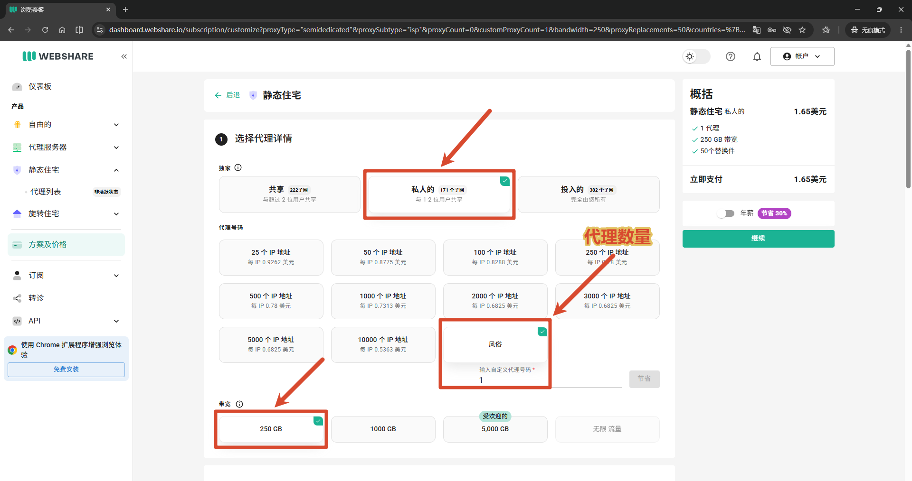
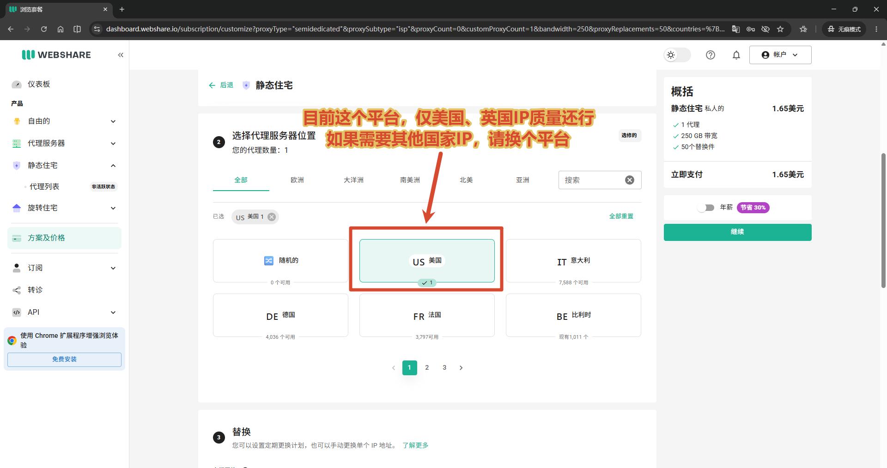
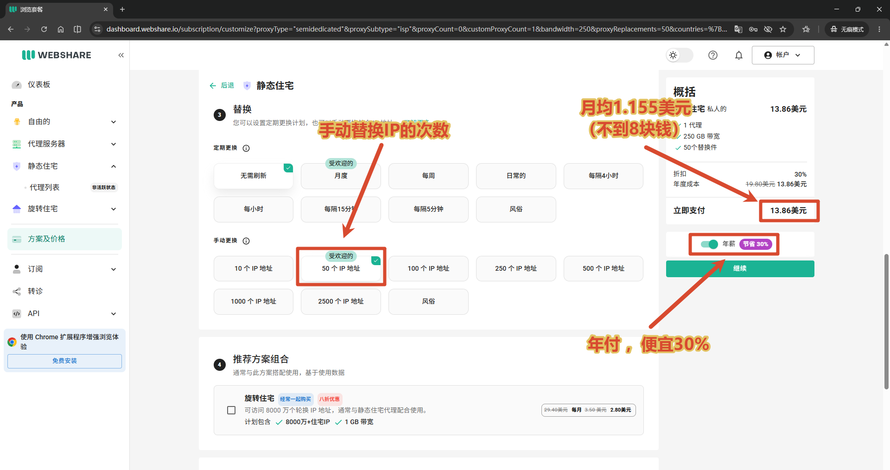
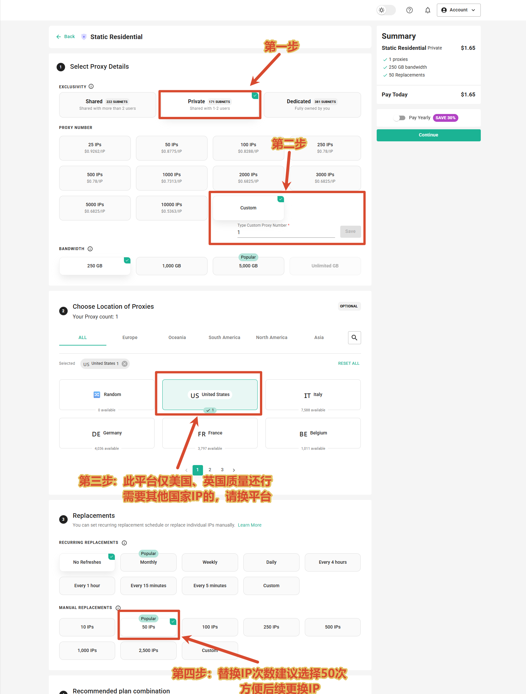
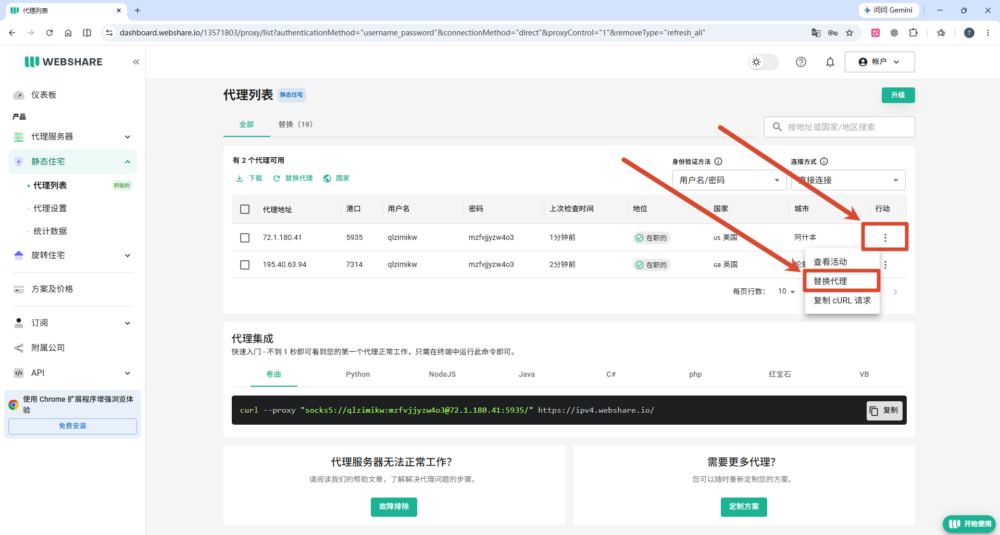
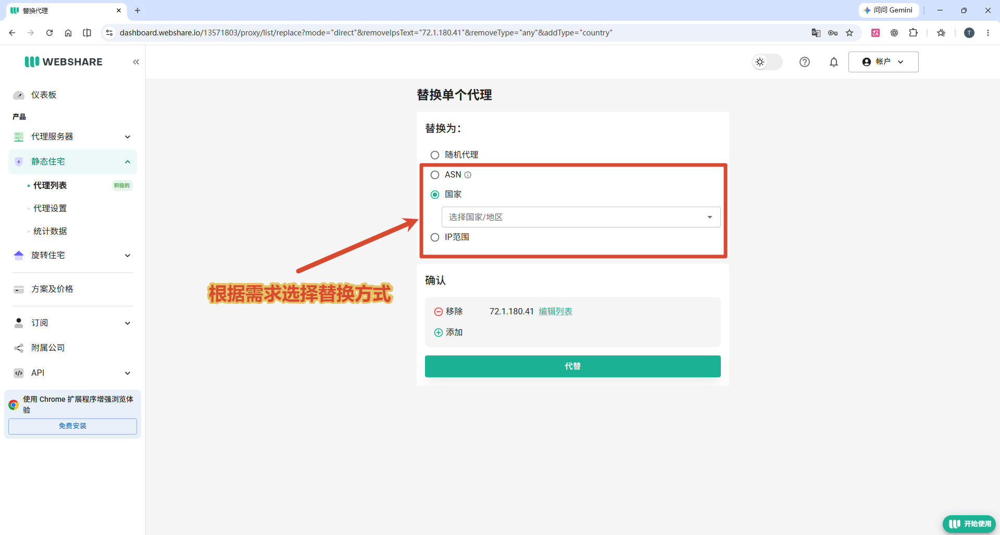
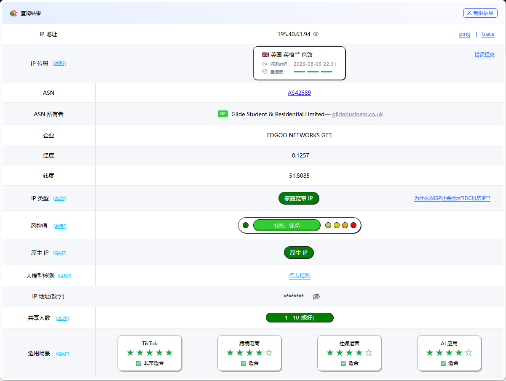

[← 返回住宅 IP 推荐表](../../../recommend/3-isp/index.md)

# 🌐 Webshare 住宅代理购买与首次使用图文教程

本文把原住宅 IP 推荐页中的套餐选择、代理替换和检测截图集中到独立教程。截图保留当时的界面与标注；页面布局、价格、可选数量和替换额度可能变化，以当前账户显示为准。

👉 **[进入 Webshare 官网／注册入口](https://www.webshare.io/?referral_code=apnsjeua21if)**

[选择套餐](#webshare-plan) · [查看与替换代理](#webshare-replace) · [出口检测](#webshare-check) · [视频配置文档](#webshare-next)

## 🧭 先确认代理产品类型 { #webshare-types }

本教程演示 **Static Residential／静态住宅（ISP）代理**。不要与 Proxy Server 机房代理或 Rotating Residential 动态住宅混选。

购买前先比较共享级别：

- **Shared**：与其他用户共享。
- **Private**：截图注明与少量其他用户共享，不能按名称理解成完全独享。
- **Dedicated**：截图标注仅分配给自己的账号，具体使用规则以对应套餐为准。

官网目前的公开静态住宅价格页展示了 **20 个 IP、6 美元／月**的入门组合，与下面旧截图的自定义单 IP 方案不同。能否继续选择截图中的组合，应以登录后的实际页面为准。

## 🛒 选择静态住宅套餐 { #webshare-plan }

### 第1步：选择共享级别与数量

登录后打开 **Plans & Pricing／方案及价格**，选择 **Static Residential／静态住宅**。原截图使用的是 **Private**，数量为 **Custom／自定义 → 1**，流量额度为 **250GB**。

图中的 **250GB 是流量额度，不是 250Mbps 端口速度**。如果当前页面不支持自定义单 IP，改按现有可选套餐比较，不要用旧截图金额估算当前应付款。

### 第2步：选择目标国家地区

在国家选择区域核对需要的出口位置。原截图以 **US／美国**为例；英国资源则选择相应国家选项。

截图中“美国、英国质量还行”是原文当时的使用经验，并不表示平台仅售这两个国家，也不保证现在分配的每条 IP 都有相同效果。

### 第3步：核对替换次数与付款周期

原截图选择 **No Refreshes／无需刷新**、**50 次人工替换**，并开启年付。是否需要自动轮换、人工替换名额及付款周期，应结合自己的使用方式和当前计费规则选择。

截图中的 **13.86 美元是当时的年度付款总额**，约等于每月 1.155 美元；它不是每月扣款，也不是当前价格。确认订单前核对总金额、续费周期和所选附加项，支付方式以结算页为准。

??? note "查看原始完整套餐对照图"
    

## 🔄 查看与替换代理 { #webshare-replace }

### 第4步：查看连接信息

开通后进入 **Static Residential → Proxy List／静态住宅 → 代理列表**，核对代理地址、端口、用户名和密码。截图选择的认证方式为**用户名／密码**，连接方式为**直接连接**。

如果需要更换某条代理，点击这一行最右侧的 **⋮**，再选择 **Replace Proxy／替换代理**。

使用自己账户生成的连接信息配置客户端；截图中的示例信息不用于实际连接。代理列表显示的“直接连接”是产品接入选项，不代表所有所在地网络都能直接访问该端口。

### 第5步：选择替换方式

在替换页面，根据需要选择**随机代理、ASN、国家或 IP 范围**。截图选择按国家替换，提交前检查要移除的旧 IP、将添加的资源及本套餐剩余替换额度。

替换后重新复制当前代理信息并更新客户端，再检查出口位置与实际连接效果。截图中的可选项和替换次数以当前套餐规则为准。

## 🔎 检查代理出口效果 { #webshare-check }

原文保留了美国、英国两条样本的检测图，检测日期均为 **2026 年 8 月 9 日**。它们用于说明应查看哪些信息，不代表当前整个资源池的质量。

### 美国出口检测样本

截图显示美国弗吉尼亚州阿什本、`AS20115`，ASN 所有者为 Charter Communications。配置自己的代理后，对照国家、ASN、出口 IP 和目标网站的实际访问结果进行判断。

### 英国出口检测样本

截图显示英国伦敦、`AS42689`，ASN 所有者为 Glide Student & Residential Limited。

同一 IP 在不同数据库可能有不同的住宅、ISP 或机房标签。检测分数可辅助比较，仍需结合实际网络表现与自己的使用需求判断。

## 🎬 视频与配置文档 { #webshare-next }

- [Webshare 与 3X-UI 链式代理视频文档](../../../blog/posts/2026-08-05-3x-ui/index.md)：继续查看节点和上游代理配置。
- [返回住宅 IP 平台推荐表](../../../recommend/3-isp/index.md)：比较其他平台与使用方式。
- [Webshare 官方静态住宅产品说明](https://www.webshare.io/static-residential-proxy)：查看当前公开产品与价格。
